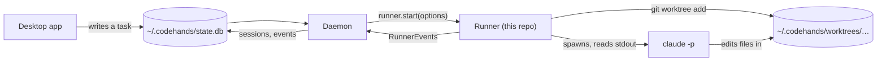
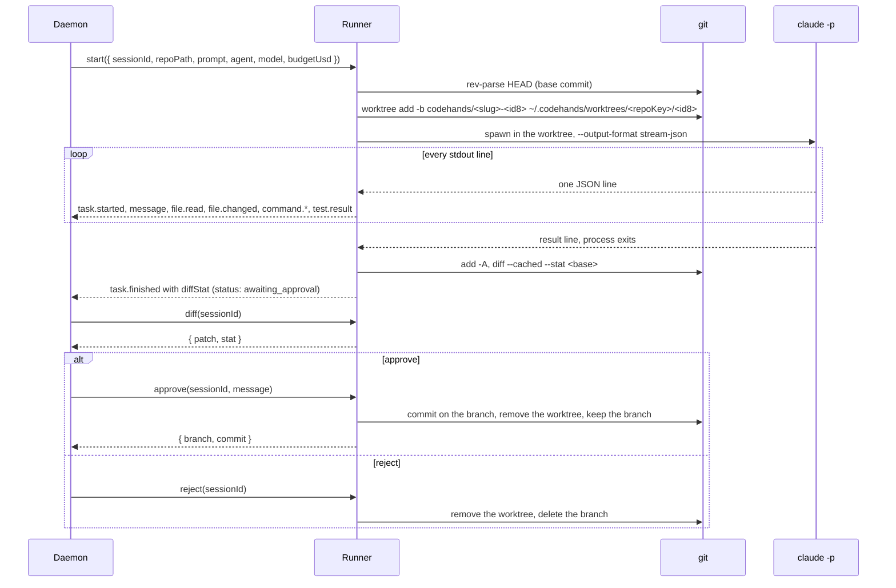

# codehands-agent

The runner. Given a repo and a prompt, it makes a private copy of the repo (a git worktree on a new branch), runs Claude Code there with no screen, and turns its output into events. A person then reads the change and approves it, which commits it on the branch, or rejects it, which deletes it. Your own checkout is never touched.

**Owner:** Tahira
**Used by:** the daemon (Midhat), which loads the runner as a library
**Contract:** C2 in [codehands-contracts](https://github.com/devweekends/codehands-contracts)
**Part of:** [Code Hands AI](https://github.com/devweekends/codehands-docs). Read the design in that README first.

## Where it sits

Everything runs on your machine. The runner is not a server and has no process of its own. The daemon imports it, calls `start()`, and stores every event it yields in the local database, where the desktop app reads them.



## What a run looks like



When it ends:

- **Approved:** the commit sits on `codehands/<slug>-<id8>` in your repo, one commit on top of the base. Your current branch did not move. Merge or push it like any branch.
- **Rejected:** the worktree and the branch are gone, as if nothing happened.
- **Failed:** a `task.failed` event says why. Approve and reject are refused.

## Status

Week 1 (Oct 19 to 23, 2026).

| Piece | File | State |
| --- | --- | --- |
| Fake runner, the stand-in the daemon builds against | [runner/src/fake-runner.ts](runner/src/fake-runner.ts) | Done |
| Session records and legal state moves | [runner/src/session-store.ts](runner/src/session-store.ts) | Done |
| `seq` 1, 2, 3 … per session | [runner/src/events.ts](runner/src/events.ts) | Done |
| Claude Code arguments and stream-json parser | [runner/src/agents/claude-code.ts](runner/src/agents/claude-code.ts) | Done, tested against a recorded run |
| Worktrees: branch names, add, remove, prune | [runner/src/git/worktree.ts](runner/src/git/worktree.ts) | Done |
| Diff since the base commit, commit on approve | [runner/src/git/diff.ts](runner/src/git/diff.ts) | Done |
| `start`, `diff`, `approve`, `reject` | [runner/src/runner.ts](runner/src/runner.ts) | Done, tested with real runs |
| `stop`: kill the whole process tree, keep the worktree | [runner/src/process/kill-tree.ts](runner/src/process/kill-tree.ts) | Done. `task.stopped` comes out of the `start()` stream; `stop()` resolves once the session is `stopped` |
| `resume`: same worktree, `seq` continues | [runner/src/runner.ts](runner/src/runner.ts) | To do. Throws `not implemented`. The `--resume` arguments exist |
| Codex: `codex exec --json` to events | [runner/src/agents/codex.ts](runner/src/agents/codex.ts) | To do. `start()` with `agent: "codex"` fails cleanly for now |
| Repo notes read before a run, summary appended after | [runner/src/memory/notes.ts](runner/src/memory/notes.ts) | To do. `repoKey()` is done |

Next, from the [design](https://github.com/devweekends/codehands-docs#who-owns-what): a model per phase, naming provider errors as one `provider.status` event (`rate_limited`, `auth_expired`, `usage_limit`, `subscription_inactive`, `down`), memory and user preferences, and two models on one task.

## Using it

```ts
import { randomUUID } from "node:crypto";
import { createRunner, createFakeRunner } from "@codehands/runner";

const runner = process.env.CODEHANDS_FAKE ? createFakeRunner() : createRunner();
const sessionId = randomUUID();

for await (const event of runner.start({
  sessionId,
  repoPath: "/path/to/repo",
  prompt: "Fix the failing test. Run npm test to check.",
  agent: "claude-code",
  model: "sonnet",
  budgetUsd: 0.5,
})) {
  console.log(event.seq, event.type, event.payload);
}

const { stat, patch } = await runner.diff(sessionId);
const { branch, commit } = await runner.approve(sessionId, "Fix the date bug");
// or: await runner.reject(sessionId);
```

### Exports

| Export | What |
| --- | --- |
| `createRunner(options?)` | The real runner. `worktreeRoot` overrides `~/.codehands/worktrees`. `agentCommand` swaps the program it runs, which is how the tests replay a recording instead of calling Claude |
| `createFakeRunner({ delayMs? })` | Emits 12 scripted events, 300 ms apart, and supports every method including stop and resume. Costs nothing, needs no repo. Build against it, and keep it as the demo backup |
| `EventSequence` | Hands out events with the next `seq` |
| `SessionStore`, `SessionRecord` | In-memory session records with the legal-move check from the contracts |
| `branchName(prompt, sessionId)`, `slugify(text)` | `codehands/fix-the-failing-test-3f2a9c1e` |

The runner keeps session records in memory only. The daemon owns the real database. A runner that restarts forgets its sessions; stop, resume and crash recovery are where that changes.

### How Claude Code's output becomes events

Each stdout line from `claude -p --output-format stream-json --verbose` is one JSON object. The parser in [claude-code.ts](runner/src/agents/claude-code.ts) maps it like this:

| Claude Code line | Event |
| --- | --- |
| `system` / `init` | `task.started` |
| `system` / `permission_denied` | `message` with `denied: true` |
| `assistant` text block | `message` |
| `assistant` tool use: Read, Glob, Grep | `file.read` |
| `assistant` tool use: Edit, Write, MultiEdit, NotebookEdit | `file.changed` |
| `assistant` tool use: Bash, PowerShell | `command.started` |
| `user` tool result for a command | `command.finished`, plus `test.result` when the command was a test run |
| `result` | `task.finished`, or `task.failed` when it is an error |
| A line that is not JSON | `message` with the raw text |
| `rate_limit_event`, thinking, other system lines | Skipped |

Some details that matter:

- One line can hold several content blocks, so one line can become several events.
- Tool results can arrive out of order, so each is matched to its tool use by id.
- A test counts as failed if its output shows failures even when the exit code says 0, because `npm test | tail` hides the exit code.
- Every event keeps the original line in `raw`. Cost and usage are passed through exactly as Claude reports them.
- `task.finished` is held back until the process has exited, so it can carry `diffStat`.

## On disk

| Path | What |
| --- | --- |
| `~/.codehands/worktrees/<repoKey>/<first 8 of sessionId>` | The task's worktree. Outside your repo so worktrees never nest, and short because of Windows path limits |
| `~/.codehands/memory/<repoKey>/notes.md` | Per-repo notes (planned) |
| `codehands/<slug>-<first 8 of sessionId>` | The task's branch, in your repo |

`repoKey` is the first 12 characters of the SHA-1 of the repo's `origin` URL, or of its absolute path when there is no origin. Two clones of the same repo share a key.

## Safety rules

The agent runs on your machine with no sandbox until the Docker box lands in week 2. Until then:

- **Run it only on our own repos.**
- Claude runs with `--permission-mode acceptEdits` and a short allow list: `Read, Edit, Write, Glob, Grep`, and only `npm test` in Bash or PowerShell. Anything else is blocked and shows up as a `message` with `denied: true`.
- **Never** `--dangerously-skip-permissions`.
- Every run passes `--max-budget-usd` (default $0.50).
- `--strict-mcp-config` keeps your own connectors (Gmail, GitHub and so on) out of agent runs.
- API keys never go into events, logs or diffs.
- The runner never writes `CLAUDE.md` or `AGENTS.md` into the worktree. They would show up in the diff.

## Set up

You need Node 22, pnpm 10, Git, and for real runs the [Claude Code](https://docs.claude.com/en/docs/claude-code) CLI, logged in.

The runner depends on the contracts by folder in week 1, so clone both side by side:

```bash
git clone https://github.com/devweekends/codehands-contracts.git
git clone https://github.com/devweekends/codehands-agent.git

cd codehands-contracts && pnpm install && pnpm build
cd ../codehands-agent/runner && pnpm install
```

```text
CodeHandsAI/
  codehands-contracts/      built first, dist/ is what the runner imports
  codehands-agent/
    runner/                 the package: "@codehands/contracts": "file:../../codehands-contracts"
```

## Commands

Run these in `runner/`.

| Command | What | Costs money |
| --- | --- | --- |
| `pnpm test` | Every test. The parser replays a recorded run, the runner tests make real git repos in a temp folder and use a stand-in for `claude` | No |
| `pnpm fake` | Prints the fake runner's events, one JSON object per line. This is exactly what the daemon receives | No |
| `pnpm try [repoPath] [prompt] [--approve \| --reject]` | One real run through the runner, one line per event, then the diff stat, then approve, reject or keep | Yes, capped at $0.50 |
| `pnpm build` | Compiles to `dist/` | No |
| `pnpm typecheck` | Type check only | No |

`pnpm try` defaults to the fixture repo at `~/codehands-fixtures/date-bug` and the prompt "Fix the failing test. Run npm test to check." Without a flag it asks what to do at the end.

The scripts in `runner/scripts/`:

| Script | What |
| --- | --- |
| `spike.sh [fixture]` | The week 1 hand spike. Runs `claude -p` once in a fresh worktree and saves the output to `test/fixtures/spike-1.jsonl` |
| `reset-fixture.sh [fixture]` | Puts the fixture repo back: removes every worktree and `codehands/*` branch, resets and cleans. Run it after `pnpm try` and before every rehearsal |

## Tests

| File | Covers |
| --- | --- |
| [claude-parser.test.ts](runner/test/claude-parser.test.ts) | The whole recorded run replays in order; each mapping above; blocked commands; failed tests hidden behind exit code 0; error results; broken lines; `raw` on every event |
| [runner.test.ts](runner/test/runner.test.ts) | A worktree on a new branch with your repo untouched; clean failures for a repo with no commits, an agent with no result line, a missing binary and an unsupported agent; diff with new files; approve commits on the branch and leaves `main` alone; reject deletes the branch; nothing to approve; stop kills the agent and its children, keeps the worktree and refuses a session that is not running |
| [fake-runner.test.ts](runner/test/fake-runner.test.ts) | Event order and `seq`; approve only after finishing; stop then resume with `seq` continuing |
| [worktree.test.ts](runner/test/worktree.test.ts) | Branch names |

To record a new fixture, run `scripts/spike.sh` (or a Codex equivalent), read every line of the output, then write tests that replay it. Never call a real agent from a test.

## Common problems

| Symptom | Cause and fix |
| --- | --- |
| `task.failed`: "is not a git repo or has no commits yet" | Worktrees need a commit to branch from. Commit something first |
| `task.failed`: "the agent exited without a result" | `claude` is not installed, not on `PATH`, or not logged in. `stderr` on the event says which |
| `fatal: '<branch>' is already checked out` or a worktree already exists | A previous run was left behind. Run `scripts/reset-fixture.sh`, or `git worktree prune` in the repo |
| Cannot find module `@codehands/contracts` | Build the contracts repo first, and check it is cloned next to `codehands-agent` |
| Child processes keep running after a stop on Windows | Killing the parent does not kill its children (`claude` → `npm test` → `node`). That is what `stopProcessTree` is for |
| "nothing to approve: the agent made no changes" | The agent changed no files. Reject the session instead |

## Contributing

- One branch per Linear issue, for example `tahira/cod-12-runner-start`. Put the issue id in the PR title.
- `main` is always green. CI runs build and test on every PR.
- A change to `StartOptions`, `RunnerEvent` or `Runner` is a contract change. It goes to [codehands-contracts](https://github.com/devweekends/codehands-contracts#changing-a-contract) first, and `createFakeRunner()` is updated the same week.
- The week by week plan is in [roadmap/tahira.md](https://github.com/devweekends/codehands-docs/blob/main/roadmap/tahira.md).
